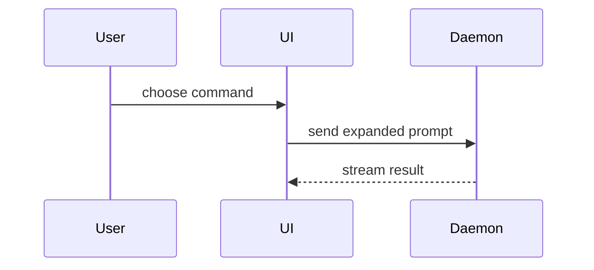

使用這個範本撰寫 PR 內文：

```markdown
## Summary（摘要）

<圖表、diff 草圖或樹狀圖>

## Evidence（證據）

- **Before（之前）:** <截圖 / 輸出 / 失敗的測試執行結果>
  **After（之後）:** <截圖 / 輸出 / 通過的測試執行結果>

## Merge Danger（合併風險）

**Door（門）:** <one-way（單向）或 two-way（雙向）>

<選填：說明>

**Blast Radius（影響範圍）:** <一個詞的描述>

<選填：合併可能造成的後果>
```

## 各段落

省略所有開場白，文字保持簡短。使用 `GLOSSARY.md` 中使用者的領域語言。

### Summary（摘要）

挑選能把重點講清楚的最小視圖。

- 用虛擬碼呈現邏輯或演算法：

```text
on(save)
  if content is unchanged
    return cached result
  write new content
  return fresh result
```

- 用呼叫樹呈現執行期的控制流程：

```text
submitForm
  createSession
    persistPrompt
    launchAgent
  navigateToSession
```

- 用元件樹呈現 UI 結構，包含重要的狀態與模組邊界：

```text
<SessionPage> (apps/example/src/routes/session.tsx)
  useSessionEvents()
  <SessionToolbar>
    <RunSkillButton> (packages/ui)
```

- 用淺層的檔案樹呈現檔案職責或大範圍的重構：

```text
src/
├── commands/       # 解析使用者操作
├── sessions/       # 擁有 session 狀態
└── transport/      # 發送 API 請求
```

- 用 Mermaid 呈現元件互動、控制流程或資料流程：



- 當重點在於「改了什麼」、而周圍的結構早已存在時，使用 `diff`。讓 diff 的形狀配合主題。

元件的變更：

```diff
 <SessionPage>
   useSessionEvents()
   <SessionToolbar>
+    <RunSkillButton />
   <SessionTimeline>
+    <SkillResultCard />
```

檔案配置的變更：

```diff
 src/
 ├── commands/
+│   └── show-me.ts       # 展開 slash command
 ├── sessions/
-└── transport.ts
+└── transport/
+    ├── client.ts
+    └── stream.ts
```

呼叫樹或呼叫堆疊的變更：

```diff
 submitForm
   createSession
     persistPrompt
+    expandSkillMention
     launchAgent
-  navigateToSession
+  navigateToSession
+    subscribeToEvents
```

狀態或控制流程的變更：

```diff
 on(save)
-  write content
+  if content is unchanged
+    return cached result
+  write new content
+  invalidate cache
```

- 當大部分內容都是新的、當省略上下文會讓歸屬或順序不清楚，或當使用者需要一個可以複製的目標形狀時，就呈現整個區塊：

```ts
function expandSkill(command: string): string {
  const skillName = command.slice(1);
  return `use the ${skillName} skill`;
}
```

#### 指引

把每個視覺化放在它所支撐的那段簡短文字旁邊。只保留回答使用者當前問題、或解決當前討論重點所需的呼叫、檔案、props、狀態與邊界。

你可以用其中一種，也可以用好幾種，但不太可能全部都用上。運用你的判斷，不要讓使用者被淹沒。

### Evidence（證據）

證明這個變更能運作的具體證據。呈現之前與之後。

截圖是 S 級證據：在環境已經準備好、而且變更是視覺上的時候使用。

基於執行的證據是 A 級。測試結果、主控台輸出。用虛擬碼呈現那個現在從失敗變成通過的確切測試。

### Merge Danger（合併風險）

描述這是單向門還是雙向門。雙向門可以走回頭，單向門則不行。容易回滾的 PR 風險較低。涉及破壞性操作或難以逆轉之決策的變更就是單向門。

影響範圍（blast radius）是這個 PR 所引入的變更可能造成的影響或波及範圍。考慮所有可能性。例如版面位移、對使用方造成的破壞、行動裝置的響應式表現等等。
